```{css, echo=FALSE}
# CSS for including pauses in printed PDF output (see bottom of lecture)
@media print {
  .has-continuation {
    display: block !important;
  }
}
.remark-code-line {
  font-size: 95%;
}
.small {
  font-size: 75%;
}
.scroll-output-full {
  height: 90%;
  overflow-y: scroll;
}
.scroll-output-75 {
  height: 75%;
  overflow-y: scroll;
}
```

```{r setup, include=FALSE}
options(htmltools.dir.version = FALSE)
library(knitr)
library(fontawesome)
knitr::opts_chunk$set(
	fig.align = "center",
	cache = FALSE,
	dpi = 300,
  warning = F,
  message = F,
	fig.height = 5,
	out.width = "80%"
)
```

# Table of Contents

1. [Prologue](#prologue)

2. [APIs](#api)

3. [Explicit API Endpoint, No Key](#nokey)

4. [Explicit API Endpoint with Key](#key)

5. [Hidden APIs](#hidden)

6. [Considerate Web Scraping](#consider)

---
class: inverse, middle
name: prologue

# Prologue

---
# Client-Side

.hi-medgrn[Last time], we learned workflows for scraping .hi-medgrn[server-side] and .hi-blue[client-side] websites.
  - Static sites with .hi-slate[rvest]
  - Dynamic or interactive sites with .hi-slate[selenider] and  .hi-slate[rvest]

.hi-purple[Today], we'll turn our attention to .hi-purple[APIs].


---
# Packages for Today

First, a few packages for today:
```{r}
pacman::p_load(lubridate, tidyverse, jsonlite, httr2, usethis, 
               fredr, XML, xml2, robotstxt, rvest)
```

--

Also recommended: [JSON Viewer](https://chromewebstore.google.com/detail/json-viewer/aimiinbnnkboelefkjlenlgimcabobli?hl=en-US&utm_source=ext_sidebar), a browser extension for Firefox and Chrome that renders JSON output nicely.
  * Alternative: [JSONView](https://jsonview.com/) for both Firefox and Chrome 


---
class: inverse, middle
name: apis

# APIs

---
# APIs

An .hi-purple[API (Application Programming Interface)] is a set of rules that carries out all this requesting, responding, and rendering. Some key concepts:

* .hi-slate[Server:] A powerful computer that runs an API.
* .hi-slate[Client:] A program that exchanges data with a server through an API.
* .hi-slate[Protocol:] The "etiquette" underlying how computers talk to each other (e.g. HTTP).
* .hi-slate[Methods:] The "verbs" that clients use to talk with a server.
  - The main one that we’ll be using is .hi-pink[GET] (i.e. ask a server to .hi-pink[retrieve information]).
  - Other common methods are POST, PUT and DELETE.
  
---
# APIs

An .hi-medgrn[API (Application Programming Interface)] is a set of rules that carries out all this requesting, responding, and rendering. Some key concepts:

* .hi-slate[Request:] What the client asks of the server (see Methods on last slide).
* .hi-slate[Response:] The server’s response. This includes:
  - .hi-blue[Status Code] (e.g. “404” if not found, or “200” if successful).
  - .hi-medgrn[Header] (i.e. meta-information about the response).
  - .hi-pink[Body] (i.e. the actual contents that we’re interested in).

---
# API Endpoints

With web APIs, we can access information *directly* from the API database if we can specify the correct URL, known as an .hi-medgrn[API endpoint].

  - Similar to normal URLs, but the resulting page is... visually unappealing 


```{r, echo = F}
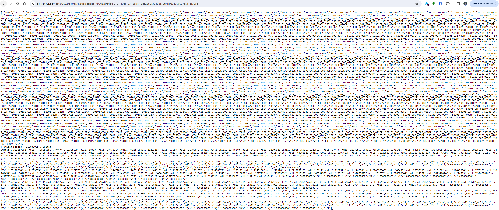
```


---
# API Endpoints

The reason the site looks like hot `r fa('trash')` is that its structured and formatted in a very particular way (that can be read directly into R!).

Usually these pages are formatted in one of two ways: .hi-red[XML] or .hi-blue[JSON]
  - We don't need too worry too much about the particular syntax of either

--

In general there are .hi-blue[three types] of API Endpoints:

1. .hi-purple[Explicit] API Endpoint, .hi-medgrn[no API Key]
--

1. .hi-purple[Explicit] API Endpoint, .hi-dkgrn[API Key Required]
--

1. .hi-pink[Hidden] API Endpoints

--

Let's work through an example workflow for each. But first...


---

# Some APIs that are free & legal

Some fun APIs:
* [TikTok (unofficial)](https://github.com/davidteather/TikTok-Api)
* [Spotify](https://developer.spotify.com/documentation/web-api/)
* [YouTube](https://developers.google.com/youtube/v3/getting-started)

This list of [Public APIs](https://github.com/public-apis/public-apis) has many more.

---

# R API Packages

Many .hi-medgrn[R packages] have been built to make directly working with APIs easier<sup>1</sup>. Some examples:
* .hi-slate[tidycensus] for [American Community Survey microdata and other Census Bureau data](https://walker-data.com/tidycensus/)
* .hi-slate[fredr] for [more easily doing what we will do today](https://cran.r-project.org/web/packages/fredr/vignettes/fredr.html)
* .hi-slate[Quandl] for [Nasdaq and other financial information](https://github.com/quandl/quandl-r)
* .hi-slate[rtweet] for [Twitter data](https://github.com/ropensci/rtweet)
* .hi-slate[rnoaa] for [NOAA weather data](https://github.com/ropensci/rnoaa)
* .hi-slate[prism] for [PRISM gridded climate data](https://github.com/ropensci/prism) (we'll work with this later on)
* .hi-slate[TADA] for [Water Quality Portal Data (EPA, USGS)](https://github.com/USEPA/TADA) 
* .hi-slate[rnassqs] for USDA's [QuickStats API](https://github.com/ropensci/rnassqs) (agricultural data)
* .hi-slate[osmdata] for [OpenStreetMap spatial data](https://cran.r-project.org/web/packages/osmdata/vignettes/osmdata.html)


.footnote[<sup>1</sup> Note that a data acquisition project for this class requires you to engage *directly* with the API. Just using one of these packages doesn't count!]


---
class: inverse, middle
name: nokey

# Explicit API Endpoint, No Key

---
# Explicit API Endpoint, No Key

Let's work through an example of the first type of API: .hi-purple[explicit API without a key].

--

Let's use the impressive [NYC Open Data](https://opendata.cityofnewyork.us/) to look at... `r fa('tree')`.

Seriously, trees. 

---
# Application 1: NYC Tree Census

First, open the [Tree Census page](https://data.cityofnewyork.us/Environment/2015-Street-Tree-Census-Tree-Data/uvpi-gqnh/about_data) in your browser (if you haven't done so already)

```{r, echo = F}
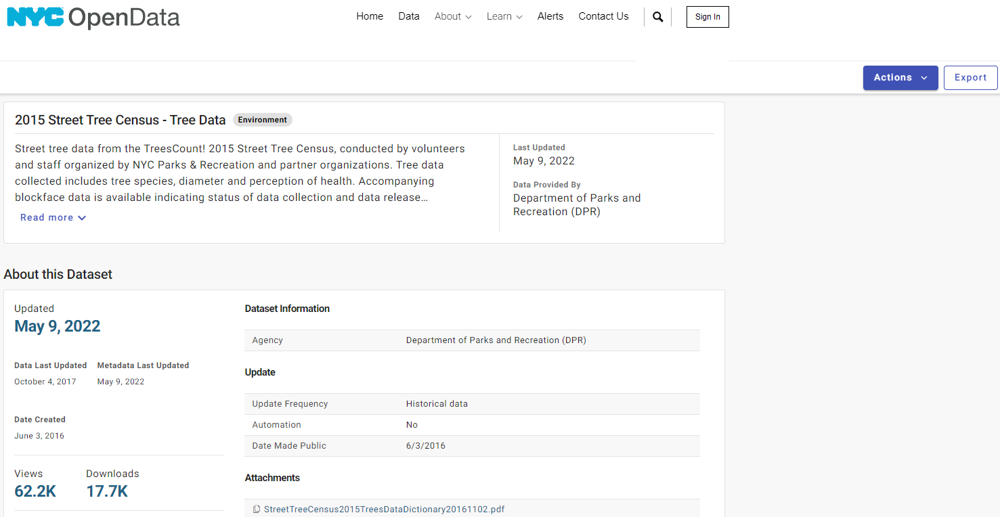
```
---
# Application 1: NYC Tree Census

Click on .hi-medgrn[Actions > API] in upper-right to display the API Endpoint

```{r, echo = F}
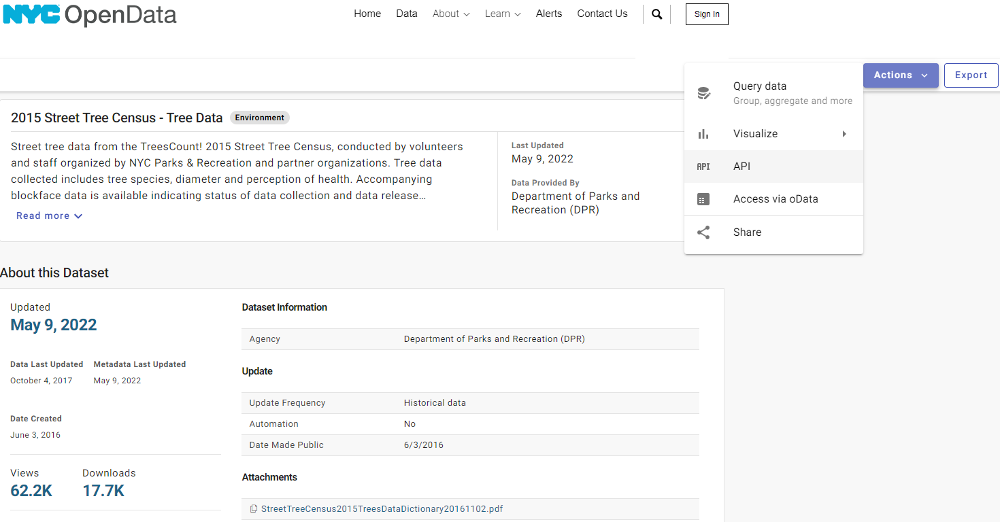
```
---
# Application 1: NYC Tree Census

Click on .hi-medgrn[Actions > API] in upper-right to display the API Endpoint

```{r, echo = F}
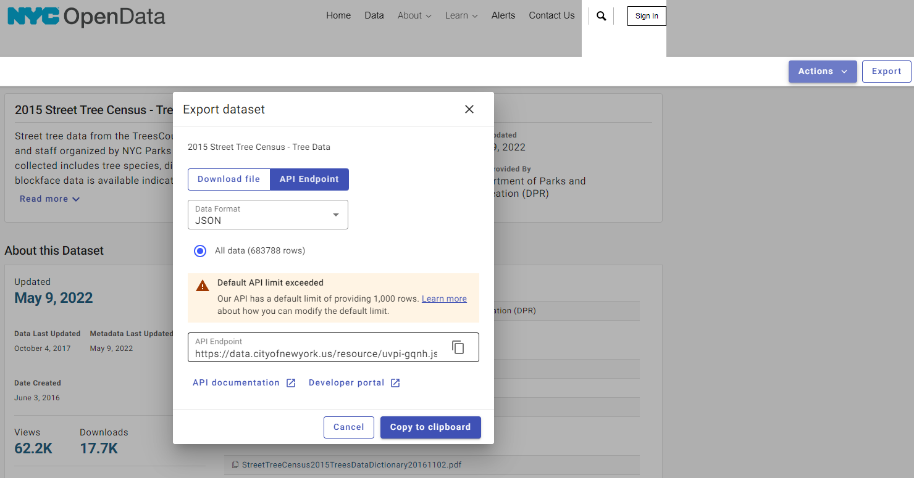
```
---
# Application 1: NYC Tree Census

Copy/Paste or click "go to" to open the API endpoint link in another tab. You'll see a bunch of JSON text.

```{r, echo = F}
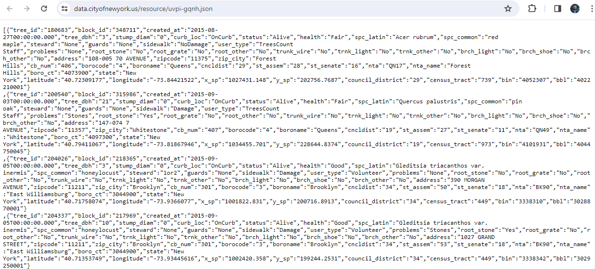
```
---
# Application 1: NYC Tree Census

If you installed JSON Viewer/JSONView, it will look a lot nicer
  * A lot like a transposed dataframe row...
```{r, echo = F}
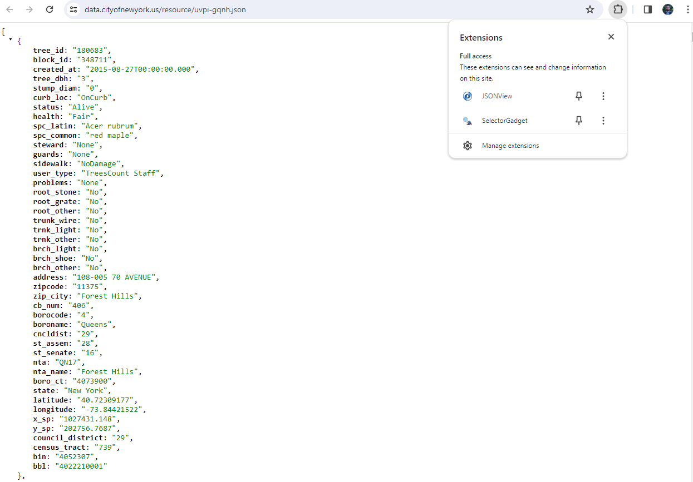
```
---
# Load JSON into R

Next, use the `fromJSON()` function in the [excellent .hi-slate[jsonlite] package](https://cran.r-project.org/web/packages/jsonlite/index.html) to read JSON into R.
 
```{r}
nyc_trees <- fromJSON("https://data.cityofnewyork.us/resource/uvpi-gqnh.json") %>%
  as.data.frame()
nyc_trees
```

---
# Aside: API Limits

Note that while the full census of NYC trees contains over 700,000 trees, we only downloaded a small portion.

By default, the API limits us to 1,000 rows.

--

For our use case (seeing an example of the workflow) this isn't an issue, but [reading the documentation](https://dev.socrata.com/docs/queries/limit.html) reveals a way to get around that (if so desired).

.hi-slate.center[Punchline: always read the API documentation!]

---
# Work with the Data

Now we have the data, accessed through an API Endpoint!

--

Seriously, that's it. Now we can do whatever we want with the data - how about plotting it?

.small[
```{r, eval = F}
nyc_trees %>% 
  select(longitude, latitude, stump_diam, spc_common, spc_latin, tree_id) %>% 
  mutate_at(vars(longitude:stump_diam), as.numeric) %>% 
  ggplot(aes(x=longitude, y=latitude, size=stump_diam)) + 
  geom_point(alpha=0.5, color = "forestgreen") +
  scale_size_continuous(name = "Stump Diameter") +
  labs(
    x = "Longitude", y = "Latitude",
    title = "Sample of New York City trees",
    caption = "Source: NYC Open Data"
    ) +
  theme_minimal()
```
]

---
# Plotting Some Trees

.small[
```{r, echo = F}
nyc_trees %>% 
  select(longitude, latitude, stump_diam, spc_common, spc_latin, tree_id) %>% 
  mutate_at(vars(longitude:stump_diam), as.numeric) %>% 
  ggplot(aes(x=longitude, y=latitude, size=stump_diam)) + 
  geom_point(alpha=0.5, color = "forestgreen") +
  scale_size_continuous(name = "Stump Diameter") +
  labs(
    x = "Longitude", y = "Latitude",
    title = "Sample of New York City trees",
    caption = "Source: NYC Open Data"
    ) +
  theme_minimal()
```
]
---
class: inverse, middle
name: key

# Explicit API Endpoint with Key

---

# Explicit API Endpoint with Key

For the second application, we're going to focus on the more common circumstance: an API endpoint that .hi-purple[requires an API key].

An .hi-purple[API key] is a way to add a .hi-purple[unique ID signature] to every API call you make
  * Required for all APIs linked to gov't agencies or institutions (e.g. Census, BEA).
  
--

Let's do an application working with the [Federal Reserve Bank of St. Louis (FRED) API](https://fred.stlouisfed.org/docs/api/fred/)

---

# Application 2: FRED API

FRED makes available a [ton of U.S. economic data](https://fred.stlouisfed.org/) that can easily be accessed via API.

```{r, echo = F}
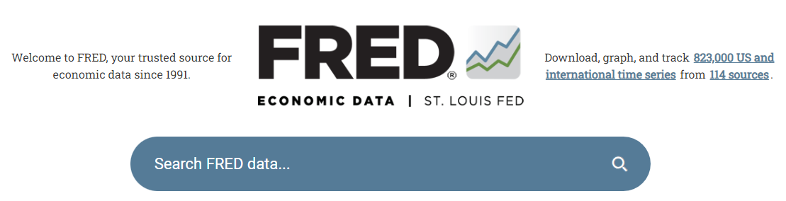
```


The only real difference from the last example: we first have to .hi-medgrn[register for an API key]

---

# Application 2: FRED API

First, navigate to the [FRED API page](https://fred.stlouisfed.org/docs/api/fred/)

```{r}
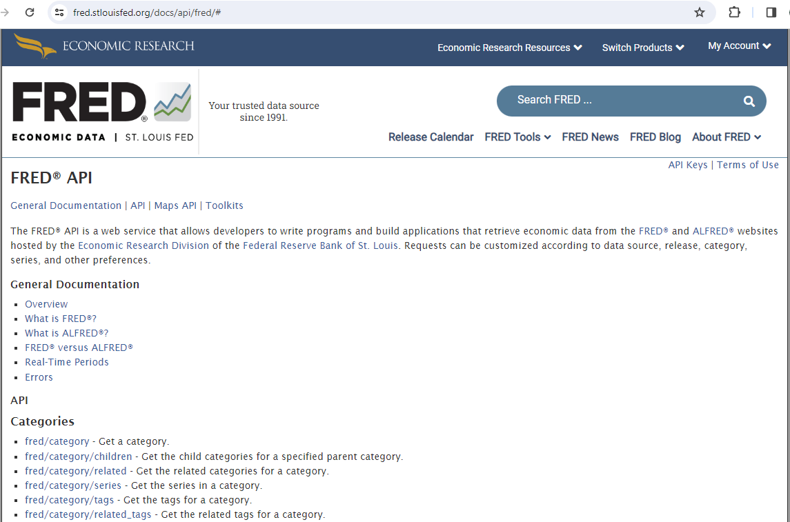
```

---

# Application 2: FRED API

Click on "API Keys" in the upper-right then "Request or view your API keys"

```{r, echo = F}
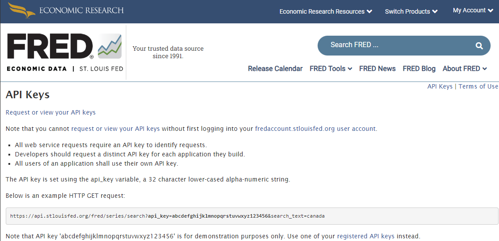
```


---

# Application 2: FRED API

Make an account, then request an API Key
  * My Account > API Keys > Request API Key
```{r, echo = F}
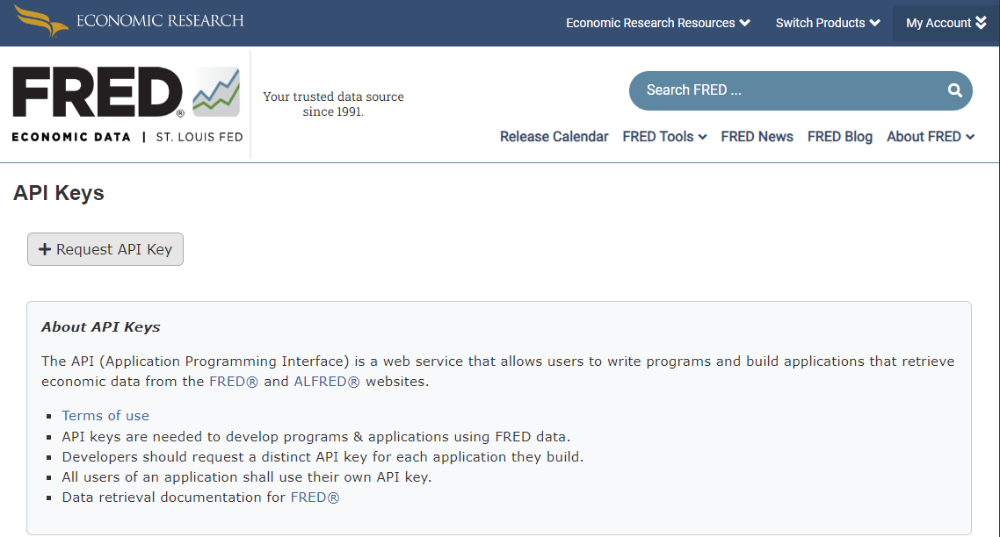
```
---

# Setting API Keys in R

Treat your API keys .hi-blue[like passwords]
  * You're responsible for following API terms & conditions, and you can't control that if someone else is using your key
  
--

This means we shouldn't ever .hi-medgrn[hardcode API keys into R scripts].

Instead, we can define them as .hi-purple[environment variables], either
  1. For the current R session only
  1. Globally across all R sessions
  
---

# Environment Variables: Current Session

To define an environment variable for .hi-medgrn[your current session only], run the following .hi-slate[in your console:]<sup>2</sup>

```{r, eval = F}
Sys.setenv(FRED_API_KEY = "YOUR_KEY_HERE")
```

Replacing the fake API key with your actual key.

You can then use an environment variable in your script with

```{r}
# assign to R object and print out
my_key <- Sys.getenv("FRED_API_KEY")
```

.footnote[<sup>2</sup> setting `Sys.setenv()` in scripts defeats the entire purpose!]
---

# Environment Variables: Globally

To set an environment variable .hi-purple[globally across all sessions], we'll need to add a special `~/.Renviron` file.
  * Text file that lives in your home directory (hence the `~/` path)
  
--

To edit, we can use the `usethis::edit_r_environ()` function:

```{r, eval = F}
usethis::edit_r_environ()
```

---

# Environment Variables: Globally

This opens your `~/.Renviron` file in a new tab, where you can easily add a line defining your API key.

```{r, echo = F}
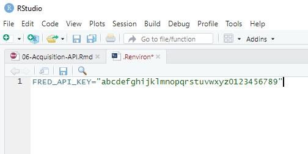
```

Hit save, then restart R or refresh your environment session to use it:

```{r}
## Only necessary when reading in a new Renviron variable
readRenviron("~/Renviron")
```

---

# Using the FRED API

With your API key set, let's figure out how to use the FRED API.

Looking at the [FRED API documentation](https://fred.stlouisfed.org/docs/api/fred/) you'll see
  * There are many types of requests you can make of FRED using the API
  * If we want the underlying data for a data series, we want the [fred/series/observations](https://fred.stlouisfed.org/docs/api/fred/series_observations.html) path.

---

# Using the FRED API

Clicking the link takes us to [specific documentation for that path](https://fred.stlouisfed.org/docs/api/fred/series_observations.html)

Here we can learn
  1. In which .hi-blue[file formats] the API will return data
  
    * XML, JSON, zipped tab delimited, zipped Excel
--

  1. The exact .hi-medgrn[syntax] for making a request
    * Potentially specific to each format
--

  1. The .hi-purple[parameters] that you can provide
    * e.g. function arguments
    
    

---

# Using the FRED API

One required parameter is `series_id`.
* Let's look at the median home listing price in East Lansing.
* By searching the FRED website, I found that the [ID](https://fred.stlouisfed.org/series/MELIPRMSA29620) for this series is `MELIPRMSA29620`.

For the `file_type`, you can use either XML or JSON.
* Both can easily be read into R.
* Since we already saw JSON, let's try using XML.

.hi-slate[Try out the API right in your browser.] Paste this into your location bar, replacing the fake API key with your own:

`https://api.stlouisfed.org/fred/series/observations?series_id=MELIPRMSA29620&api_key=YOURKEYHERE&file_type=json`

---
# Using the FRED API

To use the API in R, we'll use the tidyverse package .hi-slate[httr2] ("hitter 2"). This is an updated version of .hi-slate[httr] that adds more modern features and is pipeable!
  * I find it much more intuitive
  
  
---
# httr2 Request Worfklow

Recall that in .hi-slate[httr2], we build + execute a request object over multiple function steps:
  
  1. Create a new request object with `request()`
  2. Define the request behavior with `req_` functions
  3. Perform the request with `req_perform()`
  4. Fetch the response with `resp_` functions
  
---
# Request the FRED API

First we need to .hi-medgrn[create a request] with `request()`

```{r}
req <- request("https://api.stlouisfed.org/")
```

---
# httr2: Practice Request 

```{r}
req %>% req_dry_run()
```

Here we see that we've initiated a request of type .hi-pink[GET]. A .hi-pink[GET] method lets us "get" pre-existing data from a specific API endpoint

--

The alternative is a .hi-blue[POST] where we .hi-blue[submit data that results in creation of a new resource]
  * .hi-slate[httr2] will automatically shift to .hi-blue[POST] if we add contents to our request!


---
# httr2: Create Request

```{r, echo = F}
req %>% req_dry_run()
```

We also see 4 other useful bits of information that represent the .hi-purple[HTTP headers]

* We can modify these as needed later (i.e. the `user-agent` as before)


---
# httr2: Modify Request

Once we have our request, we can .hi-medgrn[modify it] with the `req_` functions:

.small[
| Function | Task |
| -------  | -----|
| `req_body_(raw/file/json/json_modify/form/multipart` | send data in the request body (for a POST) |
| `req_(headers/headers_redacted` | modify the request headers|
| `req_(url/url_relative/url_query/url_path/url_path_append()` | modify the request URL |
| `req_progress()` | Add a progress bar (for long requests)|
| `req_timeout()` | Set time limit for a request|
| `req_user_agent()` | Sets the user-agent of the request|
| `req_proxy()` | Send the request through a proxy server|
| `req_cookie_(preserve/set)` | set and preserve cookies |
| `req_method()` | Set request to less common methods (HEAD, DELETE, PATCH, UPDATE, OPTIONS) |
| `req_options()` | directly set libcurl options (experts only!) |
]


---
# httr2: Modify Request

Let's start by telling the request the endpoint we want to query (`fred/series/observations`).
  * Since we're appending to the FRED API url, we need `req_url_relative()`

```{r}
req <- req_url_relative(req, "fred/series/observations") #<<
req_dry_run(req)
```

---
# httr2: Modify Request

Now we need to add in some of our .hi-blue[query parameters]. 

To do this, we need to follow the .hi-blue[syntax of the API documentation:]

.center[
`?series_id=MELIPRMSA29620&api_key=YOURKEYHERE&file_type=json`
]
--

Here we have .hi-medgrn[three parameters:]
* `series_id:` which series we want to get
* `api_key:` our personal API key
* `file_type:` the format we want the file in

---
# httr2: Modify Request

We can add our .hi-blue[query parameters] using `req_url_query()`:
  * Note: the parameter names are wrapped in .hi-medgrn[backticks]!
    * i.e. ```series_id` = "MELIPRMSA29620"``
```{r}
req <- req_url_query(req,
          `series_id` = "MELIPRMSA29620",
          `api_key` = my_key,
          `file_type` = "xml")
req_dry_run(req)
```

---
# httr2: Make the Request
  
Once your request URL is set, use `req_perform()` to .hi-red[perform the request]!

```{r}
resp <- req_perform(req)
```

---
# httr2: Looking at the Response
<br>
.font90[
> <httr2_response>

> GET https://api.stlouisfed.org/fred/series/observations?series_id=MELIPRMSA29620&api_key=YOURKEYHERE&file_type=xml

> Status: 200 OK

> Content-Type: text/xml

> Body: In memory (13176 bytes)
]

Looking at our response, we see that it worked (Status: 200 OK)! 

---
# httr2: Looking at the Response

What we want to do now is extract the body, which we can do with one of the `resp_body_` functions

.center[
| Function | Task |
| -------  | -----|
| `resp_body_raw` | return the raw bytes |
| `resp_body_string` | returns a UTF-8 string |
| `resp_body_json` | returns parsed JSON |
| `resp_body_html` | returns parsed HTML |
| `resp_body_xml` | returns parsed XML |
| `resp_has_body` | logical check if the response has a body |
]

---
# httr2: Looking at the Response

We requested XML, so let's use `resp_body_xml()` to parse it:
```{r}
resp_body <- resp_body_xml(resp)
```

---
# httr2: Looking at the Response

This gets us the XML document, which 
* Starts with information about the data (start and end dates, order and sort, number of results, etc.)
* Contains each observation as a nested entry

```{r}
resp_body
```

---
# XML

See the XML structure with `xml_structure()`:

```{r}
xml_structure(resp_body)
```

---
# XML
.font80[
> <observations [realtime_start, realtime_end, observation_start, observation_end, units, output_type, file_type, order_by, sort_order, count, offset, limit]>
>  <observation [realtime_start, realtime_end, date, value]>
>  <observation [realtime_start, realtime_end, date, value]>
]
This shows us the nested structure of our body, where each row is stored in a `<observation >` element.

--

We can retrieve these all using `xml_find_all()` and the xpath argument!
* Spoiler: it turns out that xpaths are actually the syntax for navigating an XML document


```{r}
xml_find_all(resp_body, xpath = "//observation") 
```

---
# XML
.font80[
> {xml_nodeset (111)}

>  [1] <observation realtime_start="2026-10-13" realtime_end="2026-10-13" d ...

>  [2] <observation realtime_start="2026-10-13" realtime_end="2026-10-13" d ...
]

`xml_find_all()` yields an xml nodeset, where each node contains four attributes: realtime_start, realtime_end, date, and value

* `xml_attrs()` to see the attributes

```{r}
xml_find_all(resp_body, xpath = "//observation") %>%
xml_attrs()
```


---
# XML

To extract a *specific* attribute's values, use `xml_attr("attribute_name")`

--

For example, to get the `realtime_start` values:
```{r}
xml_find_all(resp_body, xpath = "//observation") %>%
xml_attr("realtime_start") %>% head()
```
---
# XML

 And we can build our dataframe!
 
```{r}
resp_df <- data.frame(
  date = xml_find_all(resp_body, xpath = "//observation") %>% xml_attr("date") %>% ymd(),
  median_price = xml_find_all(resp_body, xpath = "//observation") %>% xml_attr("value") %>% as.numeric()
)
```


---

# Using the FRED API

Plotting:

```{r, out.width = "90%", fig.height = 4, eval = F}
drop_na(resp_df) %>%
ggplot(aes(x = date, y = median_price)) +
  geom_line() +
  theme_minimal() +
  scale_y_continuous(labels = scales::label_dollar(),
                     name = "Median House Price") +
 scale_x_date(name = NULL,
               date_breaks = "1 year",
               date_labels = "%Y") +
  labs(title = "Median Home Prices in Lansing-East Lansing MSA")
```


---

# Using the FRED API

Plotting:

```{r, echo = F}
drop_na(resp_df) %>%
ggplot(aes(x = date, y = median_price)) +
  geom_line() +
  theme_minimal() +
  scale_y_continuous(labels = scales::label_dollar(),
                     name = "Median House Price") +
 scale_x_date(name = NULL,
               date_breaks = "1 year",
               date_labels = "%Y") +
  labs(title = "Median Home Prices in Lansing-East Lansing MSA")
```

---

# Challenge

.hi-medgrn[How has East Lansing's pandemic housing market compared with other cities?]
* Get similar data from 2-3 other housing markets you're interested in.
* Plot time-series graphs for each housing market.
* More advanced: combine all the results in 1 dataframe (keep it tidy!).


---
class: inverse, middle
name: hidden

# Hidden APIs

---
# Hidden APIs

The third kind of APIs are known as .hi-blue[Hidden APIs].

These are endpoints used for a website's .hi-medgrn[Internal page generation] and is not intended for public use.
  * For example, Airbnb uses or has used a hidden API to display search results on its web interface.
  * Grant McDermott has an [example](https://raw.githack.com/uo-ec607/lectures/master/07-web-apis/07-web-apis.html#Application_3:_World_rugby_rankings) of how to find and use hidden APIs.
  * We're not going to go in-depth into hidden API access because...

---
# Hidden APIs

One caveat: the legality of using hidden APIs is .hi-blue[less clear]
  * In April 2022 (*HiQ Labs v. LinkedIn*), the Ninth Circuit Court of Appeals held that webscraping is legal in the U.S. so long as the data is .hi-purple[publicly available]
  * Do hidden APIs constitute publicly available information?

--

Even if generally legal, web scraping may be a violation of a website's Terms & Conditions
  * Airbnb: "Do not use bots, crawlers, scrapers, or other automated means to access or collect data or other content from or otherwise interact with the Airbnb Platform."
  * Your IP could be blocked or your account could be blocked/blacklisted


---
class: inverse, middle
name: consider

# Considerate Web Scraping

---
# Considerate Web Scraping

In addition to our internal evaluation of

  > Just because we can, doesn't mean we should

another useful tool in this process is .hi-medgrn[checking for and reading the robots.txt file].


Many sites have a `robots.txt` file that outlines what parts of the site web crawlers *can* and *can't* access.

  * Specific pages or API endpoints
  * Specific types of users
  * Speeds at which you can scrape

---
# Considerate Web Scraping

The .hi-slate[robotstxt] package makes it easy to check for and read these files. For example, Wikipedia:
.small[
```{r}
get_robotstxt(domain = "https://www.wikipedia.org")
```
]
---
# Robots.txt

For more than just the text, use the `robotstxt()` function instead:

.small[
```{r}
rtxt <- robotstxt(domain = "wikipedia.org")
rtxt
```
]

---
# Robots.txt

We can check what's allowed, including

.pull-left[
.center.hi-medgrn[Page Permissions]
```{r}
rtxt$permissions
```
]
.pull-right[
.center.hi-medgrn[Crawl Delay]
```{r}
rtxt$crawl_delay
```
]

---
# Considerate Web Scraping

Another great R package is .hi-slate[polite], which builds upon .hi-slate[rvest] to provide a workflow that both queries the `robots.txt` file and performs the scraping itself.

Two main functions/steps:
--

.pull-left[
.center.hi-medgrn[`bow()`]

  * Introduces the client to the host
  * Asks permission to web scrape
    * Inquires against the `robots.txt`
]
--

.pull-right[
.center.hi-purple[`scrape()`]

  * Retrieves data from the remote server
]

---
# polite

Let's see an example by getting [Des Linden's 2024 NYC Marathon Results](https://www.runnersworld.com/races-places/a62786311/des-linden-11th-new-york-city-marathon-2024/).


```{r, echo = F}

```

---
# polite

Installing .hi-slate[polite] direct from GitHub:<sup>3</sup>

```{r}
remotes::install_github("dmi3kno/polite")
pacman::p_load(polite)
```

.footnote[<sup>3</sup> .hi-slate[polite] was recently delisted from CRAN for the  [test site cheese.com being down](https://cran-archive.r-project.org/web/checks/2026/2026-09-12_check_results_polite.html). It's back up so should be relisted soon, but for now we need to install it from GitHub.]

---
# polite


Start by introducing yourself with `bow()`:

```{r}
bow("https://www.runnersworld.com/races-places/a62786311/des-linden-11th-new-york-city-marathon-2024/", verbose = T)
```

---
# polite


```
## <polite session> https://www.runnersworld.com/races-places/a62786311/des-linden-11th-new-york-city-marathon-2024/
##     User-agent: polite R package
##     robots.txt: 52 rules are defined for 6 bots
##    Crawl delay: 5 sec
##   The path is scrapable for this user-agent
```


`bow()` creates a .hi-medgrn[polite session] and tells us what's allowed given the rules outlined in the `robots.txt`.
  * Here, we start with a 5 sec delay.
    * To change the time, use `set_scrape_delay(time)`


---
# polite

Now, let's try and scrape the results page using `scrape()`. Arguments:
  * bow: the polite session
  * query: anything you want to append to the url
  * accept: what type of data to expect (e.g. HTML, JSON, CSV)
  * verbose: extra feedback


```{r}
rw_session <- bow("https://www.runnersworld.com/races-places/a62786311/des-linden-11th-new-york-city-marathon-2024/", verbose = T)

rw_des_24 <- scrape(rw_session, accept = "html")
```


---
# polite robots.txt

We can view the robots file directly from our session as the `$robotstxt` object:

.font80[
```{r}
rw_session$robotstxt
```
]

---
# polite

What did we get back?

```{r}
rw_des_24
```

--
**A:** an HTML document, that we know how to interact with!


---
# polite

Using .hi-slate[rvest] methods to retrieve the text:

```{r}
pars <- html_elements(rw_des_24, ".article-body-content") %>%
  html_elements("p")
pars[[1]] %>%
  html_text2() %>%
  str_extract("[0-9]:[0-9]+:[0-9]+")
```
---
# Considerate Web Scraping

.hi-medgrn[Best Practices] for considerate web scraping:

  * Check the `robots.txt` file and scrape what's allowed
  * If no  `robots.txt` file exists, stick to
    1. Public information
    1. Scraped at a reasonable speed (i.e. human frequency)
  * Scrape the data .hi-blue[once], not .hi-dkgrn[every time you run the script]
  * Ask yourself: "would I feel comfortable having an undergrad RA scrape this?"


---

# Table of Contents

1. [Prologue](#prologue)

2. [APIs](#api)

3. [Explicit API Endpoint, No Key](#nokey)

4. [Explicit API Endpoint with Key](#key)

5. [Hidden APIs](#hidden)

6. [Considerate Web Scraping](#consider)

```{r gen_pdf, include = FALSE, cache = FALSE, eval = FALSE}
infile = list.files(pattern = 'API.html')
pagedown::chrome_print(input = infile, timeout = 200)
```