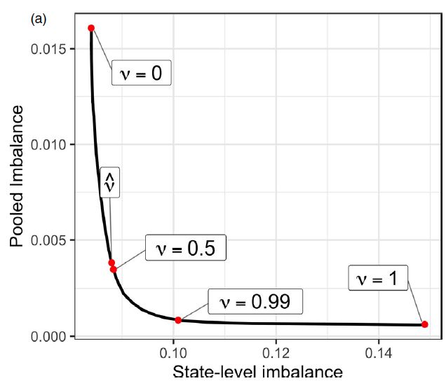
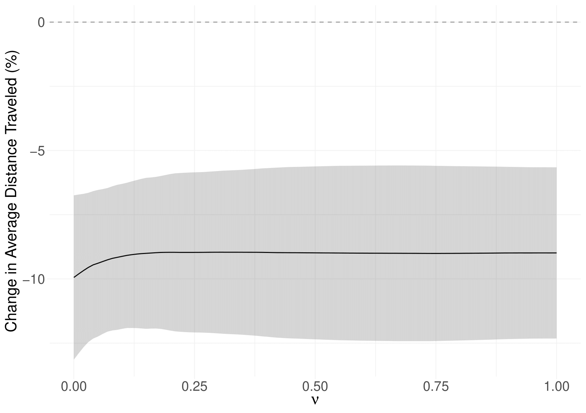

```{css, echo=FALSE}
# CSS for including pauses in printed PDF output (see bottom of lecture)
@media print {
  .has-continuation {
    display: block !important;
  }
}
.remark-code-line {
  font-size: 95%;
}
.small {
  font-size: 75%;
}
.scroll-output-full {
  height: 90%;
  overflow-y: scroll;
}
.scroll-output-75 {
  height: 75%;
  overflow-y: scroll;
}
```

```{r setup, include=FALSE}
options(htmltools.dir.version = FALSE)
library(knitr)
library(fontawesome)

# define colors
red_pink <- "#e64173"
turquoise <- "#20B2AA"
orange <- "#FFA500"
red <- "#fb6107"
blue <- "#3b3b9a"
green <- "#8bb174"
grey_light <- "grey70"
grey_mid <- "grey50"
grey_dark <- "grey20"
purple <- "#6A5ACD"
slate <- "#314f4f"

knitr::opts_chunk$set(
	fig.align = "center",
	cache = FALSE,
	dpi = 300,
  warning = F,
  message = F,
	fig.height = 5,
	out.width = "80%"
)
```

# Table of Contents


1. [Prologue](#prologue)

2. [Synthetic Difference-in-Difference](#synthdid)

3. [Partially Pooled Synthetic Control](#pool)

4. [Synthetic Control Prediction Intervals](#scpi)

5. [SCM Assumptions](#assume)

6. [Not Covered: PPSCM Application](#ppscm_ex)
  
---
class: inverse, middle
name: prologue

# Prologue

---
# Prologue

.pull-left[
.center.hi-purple[Part 1]
  * Matching
  * Canonical Synthetic Control
]

.pull-right[
.center.hi-pink[Part 2]
  * Synthetic Diff-in-Diff
    * Uniform Adoption
    * Staggered Adoption
  * Partially Pooled Synthetic Control
  * Synthetic Control Prediction Intervals

]

---
# Prologue

Packages we'll use today:


```{r}
if (!require("synthdid")) remotes::install_github("synth-inference/synthdid")
if (!require("pacman")) install.packages("pacman")
pacman::p_load(fixest, gsynth, scpi, synthdid, tidyverse)
```

--

As well, let's load the event study data from [Sears et al. (2023)](https://doi.org/10.1086/721705) we finished last lecture with (plus some covariates)

```{r}
sah <- readRDS("data/sah_covar.rds")
```

---
# Prologue

Last time we talked through the canonical .hi-medgrn[Synthetic Control Method (SCM)] for comparative case studies.

While it provides an avenue for overcoming violations of parallel trends, it is limited in several ways

  1. Intended for a single treated aggregate unit ("comparative case studies")
  1. Results primarily presented visually
  1. Inference doesn't match our usual approaches

--

What would be *great* is if there were ways of combining the matching benefits of SCM with the identification and structure of our typical econometric approaches...

---
# Prologue

Okay so I've already spoiled this: yes, there are methods that do this - and we're going to learn about them today.

1. .hi-medgrn[Synthetic Difference-in-Differences]: using a synthetic control unit as the counterfactual in a difference-in-differences
1. .hi-blue[Partially Pooled Synthetic Control:] first to extend to event study settings with dynamic treatment effects
1. [Cattaneo et al. (2025)](https://direct.mit.edu/rest/articles-abstract/doi/10.1162/rest_a_01588/128894/Uncertainty-Quantification-in-Synthetic-Controls?redirectedFrom=fulltext) formalizes uncertainty for a range of estimands of interest

--

We refer to these approaches as .hi-purple[doubly-robust] estimators, in that you have two chances to be right:
  
  1. In the matching design, or
  2. In the regression specification

---
class: inverse, middle
name: synthdid

# Synthetic Difference-in-Differences

---
# Synthetic Difference-in-Differences

[Synthetic Difference-in-Differences](https://www.aeaweb.org/articles?id=10.1257/aer.20190159) by Arkhangelsky et al. (2021) AER offers a solution to CIA violations in a typical difference-in-differences setting.

--

.hi-medgrn[The gist:]

  1. Re-weight and match pre-exposure trends by constructing a synthetic counterfactual
    * Reduces reliance on parallel trends
  1. Estimate a treatment effect in a standard TWFE regression
  
---
# Synthetic Difference-in-Differences

.hi-blue[More formally:]

Suppose you have .hi-green[balanced panel] with 
  * $T$ time periods
  * $N$ units
    * First $N_{co}$ units are never exposed to treatment (pure controls)
    * Next $N_{tr} = N - N_{co}$ units receive treatment after time $T_{pre}$
      * Can be block adoption or staggered adoption
  
--

You observe

  * The time-varying outcome $Y_{it}$,
  * A binary treatment indicator $W_{it}$,
  * and (optionally) time-varying covariates $X_{it}$
  
i.e. same data requirements as a standard TWFE Diff-in-Diff approach

---
# Synthetic Difference-in-Differences

.hi-blue[The Concern:]  even after conditioning on observables, CIA/parallel trends doesn't hold.

--

.hi-medgrn[The Solution:] construct a synthetic control to use as the counterfactual in a Difference-in-Differences design.

Like with SCM, the goal is to find weights $\hat\omega^{sdid}$ so that the pre-treatment trends in the treated units' outcome align with the synthetic control's:

$$\underbrace{\sum\limits_{i=1}^{N_{co}} \hat\omega^{sdid} Y_{it}}_{Synthetic ~ Control}~~ \approx ~~\underbrace{\frac{1}{N_{tr}} \sum\limits_{i= N_{co}+1}^N Y_{it}}_{Treated}$$
---
# Synthetic Difference-in-Differences

.hi-purple[Choosing Unit Weights:] ensure average outcome for treated unit(s) is roughly parallel to the synthetic counterfactual (i.e. weighted average of control units)

--

Choose .hi-purple[unit weights] $(\hat\omega_0, \hat\omega)$ that yield the arg min of

$$\underbrace{\sum\limits_{t=1}^{T_{pre}}\left(\omega_0 +  \sum\limits_{i=1}^{N_{co}} \omega_i Y_{it} - \frac{1}{N_{tr}} \sum\limits_{i= N_{co}+1}^N Y_{it} \right)^2}_{Sum~Squared~Error} + \underbrace{\zeta^2 T_{pre} ||\omega||^2_2}_{L_2~Regularization~Penalty}$$


---
# Synthetic Difference-in-Differences

$$\underbrace{\sum\limits_{t=1}^{T_{pre}}\left(\omega_0 +  \sum\limits_{i=1}^{N_{co}} \omega_i Y_{it} - \frac{1}{N_{tr}} \sum\limits_{i= N_{co}+1}^N Y_{it} \right)^2}_{Sum~Squared~Error} + \underbrace{\zeta^2 T_{pre} ||\omega||^2_2}_{L_2~Regularization~Penalty}$$

  * Intercept term $\omega_0$ allows synthetic control to match on pre-trends
    * Unit FE $\alpha_i$ in regression step get rid of level differences
  * Penalty term helps non-zero weights be more distributed across control units
    * If $\zeta=0$, weights are identical to Abadie, Diamond, and Hainmueller (2010) SCM weights for a single treated unit 
    * $\zeta$ is *complicated*, see the paper if you want more details
    * $L_2$/Euclidean norm as in ridge regression (we'll chat more about this in ML lecture)

---
# Synthetic Difference-in-Differences

.hi-medgrn[Choosing Time Weights:] ensure pre and post-treatment periods are balanced for control units
  
Choose .hi-medgrn[time weights] $(\hat\lambda_0, \hat\lambda)$ that yield arg min of


$$\sum\limits_{i=1}^{N_{co}}\left(\underbrace{\lambda_0 +  \sum\limits_{t=1}^{T_{pre}} \hat\lambda_t Y_{it}}_{Weighted~Average\\~in~Pre-Period} ~~-~~ \underbrace{\frac{1}{T_{post}} \sum\limits_{t= T_{pre}+1}^T Y_{it}}_{Average~in\\Post-Period} \right)^2$$
  * No regularization in time weights
    * Allows for correlation over time for same unit, but not across units (beyond the systematic component in a latent factor model)
  
---
# Synthetic Difference-in-Differences

Once unit and time weights (and $\zeta$) are obtained, estimate $\hat\tau^{sdid}$ as arg min of 

$$\sum\limits_{i=1}^N\sum\limits_{t=1}^T  (Y_{it} - \mu - \alpha_i - \beta_t - W_{it} \tau)^2\hat\omega_i^{sdid}\hat\lambda_t^{sdid}$$
--
<br>

Note that without weights, this is just the TWFE Diff-in-Diff solution: 

$$\sum\limits_{i=1}^N\sum\limits_{t=1}^T  (Y_{it} - \mu - \alpha_i - \beta_t - W_{it} \tau)^2$$

---
# Synthetic Diff-in-Diff Application

Now that we know how it's working, let's try it out by looking at the impact of California's Proposition 99, which introduced a 25 cent tax per pack of cigarettes sold from January 1989 onward.

```{r}
data(california_prop99)
```


---
# Synthetic Diff-in-Diff Application

We *could* evaluate the impact of Prop 99 on cigarette sales per capita using a typical TWFE Diff-in-Diff:


```{r}
did <- feols(PacksPerCapita ~ treated | State + Year, data = california_prop99, cluster = ~ State)
summary(did)
```

---
# Synthetic Diff-in-Diff Application

Looking at parallel trends:
.font70[
```{r, out.width = "60%"}
mutate(california_prop99, state_ca = ifelse(State == "California", "California", "Pure Controls")) %>%
group_by(state_ca, Year) %>%
  summarise(PacksPerCapita = mean(PacksPerCapita)) %>%
  filter(Year <= 1989) %>%
  ggplot() +
  geom_line(aes(x = Year, y = PacksPerCapita, linetype = state_ca)) +
  geom_vline(aes(xintercept = 1989), linetype = "dashed", color = "gray70", alpha = 0.7) +
  theme_minimal()
```
]

---
# Synthetic Diff-in-Diff Application

Let's use the .hi-slate[synthdid] package to estimate a diff-in-diff using a synthetic California as the counterfactual.

First, we'll need to do some se the `panel.matrices()` function to set up the data

  * Balanced panel (have)
  * Simultaneous adoption (have mechanically)

```{r}
synth_ca_prep <- panel.matrices(
  panel = as.data.frame(california_prop99), # the dataframe
  unit = "State", # unit column (name or column #)
  time = 2, # time column (name or column #)
  outcome = 3, # outcome var (name or column #)
  treatment = "treated", # treatment var (name or column #)
  treated.last = TRUE # sort treated units to be at bottom
)
```

---
# Synthetic Diff-in-Diff Application

Now compute the synthetic Diff-in-Diff estimate with `synthdid_estimate()`:

```{r}
sdid <- synthdid_estimate(Y = synth_ca_prep$Y, # outcome var
                          N0 = synth_ca_prep$N0, # number of control units (N_co)
                          T0 = synth_ca_prep$T0 # number of pre-treatment periods (T_pre)
                          )
sdid
```
Which yields a much smaller treatment effect estimate than the Diff-in-Diff (`r coeftable(did)["treated", "Estimate"] %>% round(1)`).

---
# Synthetic Diff-in-Diff Application

Looking at control unit weights $\omega$:

```{r}
synthdid_controls(sdid)
```


---
# Synthetic Diff-in-Diff Application

Plotting the  control unit weights $\omega$:

```{r}
synthdid_units_plot(sdid)
```

---
# Synthetic Diff-in-Diff Application

And the time weights $\lambda$

```{r}
summary(sdid)$periods
```
---
# Synthetic Diff-in-Diff Application

Note that with only one treated unit we can only use the (untrustworthy) `placebo` method to get standard errors, by calling `vcov()` on our `synthdid_estimate` object:

```{r}
se <- sqrt(vcov(sdid, method='placebo'))
sprintf('95%% CI (%1.2f, %1.2f)', sdid - 1.96 * se, sdid + 1.96 * se)
```


---
# Synthetic Diff-in-Diff Application

We can look at pre-treatment parallel trends by overlaying the two series:
  
```{r, out.width = "65%"}
synthdid_plot(sdid, overlay = 1)
```


---
# Synthetic Diff-in-Diff Application

The built-in `synthdid` plot (a `ggplot` object) displays a lot of information by default.

  * Point and line segments for simple 2x2 Diff-in-Diff comparison
  * Time period weights (bottom red line)
  * Customizable further with `theme()` and [other adjustments](https://synth-inference.github.io/synthdid/articles/more-plotting.html)

---
# Synthetic Diff-in-Diff Application

The built-in `synthdid` plot (a `ggplot` object) displays a lot of information by default.

 
```{r, out.width = "65%"}
synthdid_plot(sdid)
```


---
# Synthetic Diff-in-Diff Application

Comparing to canonical SCM and Diff-in-Diff reveals the differences well:

```{r}
est_sc <- sc_estimate(Y = synth_ca_prep$Y, N0 = synth_ca_prep$N0, T0 = synth_ca_prep$T0)
est_did <- did_estimate(Y = synth_ca_prep$Y, N0 = synth_ca_prep$N0, T0 = synth_ca_prep$T0)
estimates <- list(est_did, est_sc, sdid)
names(estimates) = c('Diff-in-Diff', 'Synthetic Control', 'Synthetic Diff-in-Diff')
print(unlist(estimates))
```

---
# Synthetic Diff-in-Diff Application

Comparing to canonical SCM and Diff-in-Diff reveals the differences well:

```{r}
synthdid_plot(estimates, se.method='placebo')
```

---
# Staggered Adoption

The methods in .hi-slate[synthdid] easily extend to 

  * Controlling for covariates in the second step regression
  * Cases of more than one unit .hi-belu[adopting simultaneously].

--

One current limitation is lack of direct support for .hi-medgrn[staggered adoption]

--

Until they add native support, you can use the .hi-slate[Ssynthdid] package

```{r, eval = F}
# install.remotes("remotes")
remotes::install_github("tjhon/ssynthdid")
```


---
class: inverse, middle
name: pool

# Partially Pooled Synthetic Control

---
# Partially Pooled Synthetic Control

An alternate but related estimator is the .hi-medgrn[partially pooled synthetic control method (PPSCM)] of [Ben-Michael, Feller, and Rothstein (2021)](https://rss.onlinelibrary.wiley.com/doi/10.1111/rssb.12448), which extends canonical SCM to the .hi-purple[many-treated unit] and .hi-blue[staggered adoption] cases

They additionally

  * Incorporate unit-level intercepts and balancing on covariates
    * Equivalent to balancing on residualized unit-level outcomes
  * Estimate dynamic treatment effects 
  * Obtain standard errors through bootstrapping/jackknifing
    * No formal guarantees for consistency/bias though


---
# Partially Pooled Synthetic Control

.hi-blue[More formally:]

Suppose you have a panel with 
  * $T$ time periods
  * $N$ units
    * Some units $j=1...,J$ receive treatment, potentially at different times $T_i$
    * Non-zero number of pure controls $N_0$ with $T_i = \infty$
      * Can be block adoption or staggered adoption
  
--

You observe

  * The time-varying outcome $Y_{it}$,
  * A binary treatment indicator $W_{it}$,
  * and (optionally) time-varying covariates $X_{it}$
  
---
# Partially Pooled Synthetic Control

.hi-blue[Assumptions:] 

  * Stable treatment and no interference across units (SUTVA)
  * Prior to treatment, a unit's potential outcomes are equal to its never-treated potential outcomes
  * .hi-green[No Anticipation:] 
  
  $$Y_{it}(s) = Y_{it}(\infty) \text{ for } t<s, \text{ with treatment time } s$$

---
# Partially Pooled Synthetic Control

.hi-blue[Assumptions:] 

  * All treated units are observed for at least several pre-periods and several post-periods
    * Needed to ensure sufficient identification in unbalanced event time
--
  * Can express the data generating process as following
    1. Following a time-varying $AR(L)$ process: $Y_{it}(\infty) = \sum\limits_{\ell = 1}^L \rho_{t\ell}Y_{it-\ell}(\infty) + \epsilon_{it}$, or
      * Rules out correlation between treatment timing and noise terms for any period
    1. Composed of time-varying latent factors and time-invariant unit loadings: $Y_{it}(\infty) = \phi_i \cdot \mu_t + \epsilon_{it}$
      * Rules out correlation between treatment timing and noise terms *after* treatment
    1. Noise term $\epsilon_{it}$ are sub-Gaussian random variables
      * Restricts tails to ensure finite sample error bounds 


---
# Partially Pooled Synthetic Control

If we want to extend canonical SCM to the .hi-blue[many-treated] case, we could take one of two approaches.

.hi-medgrn[1\. Separate SCM:] estimate a separate SCM for each treated unit
  * i.e. minimize pre-treatment imbalance for each treated unit separately
  * Can lead to poor mean fit, biasing the ATE
  
--

.hi-purple[2\. Pooled SCM:] estimate one SCM for average of treated units
  * i.e. minimize the average pre-treatment imbalance across all treated units
  * Can achieve strong average fit but obtain poor unit-specific treatment effects
  
--

.hi-green[The Solution:] "pool" the two estimators, improving on each approach in isolation

---
# Partially Pooled Synthetic Control

Choose SCM weights to minimize the weighted average of the pooled and unit-specific pre-treatment balance:

$$\min\limits_{\Gamma \in \Delta^{scm}}~~ \nu(\underbrace{\tilde{q}^{pool}(\Gamma))^2}_{\text{Normalized}\\\text{pooled}\\\text{imbalance}} + (1-\nu)(\underbrace{\tilde{q}^{sep}(\Gamma))^2}_{\text{Normalized}\\\text{separate}\\\text{imbalance}} + \underbrace{\lambda||\Gamma||^2_F}_{\text{penalize sum of}\\\text{squared weights}}$$

  * $\hat q^{sep},~ \hat q^{pool}$ the (normalized) root mean square of separate and pooled pre-treatment fit
  * $\lambda||\Gamma||^2_F$ a penalty term (as in SCM)
  * $\nu$ the hyperparameter determining the degree of "partial pooling"
    * $\nu = 0 \Rightarrow \text{Separate SCM}$
    * $\nu = 1 \Rightarrow \text{Pooled SCM}$
    * $0 < \nu < 1 \Rightarrow \text{Partially-Pooled SCM}$
    
---
# Partially Pooled Synthetic Control

So, what $\nu$ should we use?

--

Turns out the relationship between pooled and separate imbalance is .hi-green[highly convex], with even slight interior $\nu$ offering large improvements.

```{r, echo = F, out.width = "480"}

```


---
# Partially Pooled Synthetic Control

So, what $\nu$ should we use?


In my experience, overall ATEs are highly similar across the space of $\nu$


```{r, echo = F, out.width = "550"}

```

---
# Quantifying Uncertainty

Partially Pooled SCM relies upon a .hi-medgrn[wild bootstrap] for inference, but no guarantees are provided for ensuring its (asymptotic) validity.

--

Fortunately, [Cattaneo et al. (2025) REStat](https://doi.org/10.1162/rest_a_01588).super[.pink[†]] formalize methods for both .hi-medgrn[in-sample] and .hi-red[out-of-sample] uncertainty in the multiple treatment unit staggered adoption SCM case that guarantee coverage probabilities non-asymptotically.

--

* Also: provide for estimation + inference of unit-time, unit-average, and time-average effects
* Also also: allow for a wide range of alternate weighting constraints, multiple features, and covariate adjustment
* Also also also: built an r package .hi-slate[scpi] to implement all this

.footnote[.pink[†] Downside: it's quite new so there [aren't a lot of examples](https://onlinelibrary.wiley.com/doi/10.1002/jae.70080) yet.]


---
class: inverse, middle
name: scpi

# Synthetic Control Prediction Intervals

---
# Cattaneo et al. SCPI

Cattaneo et al. start from a general SCM framework:

  * Consider $J_0$ never-treated units and $J_1$ eventually-treated
  * Let $Y_{j,T_j+k}^{T_j}(1)$ be the observed outcome at event time $k$ for a unit $j$ that receives treatment at time $T_j$
  * We want to impute the unobserved counterfactual $\widehat{Y}_{j, T_j+k}^{T_j}(0)$ as a weighted combination of units in the donor pool $N_0$
    * Constant $\alpha_j$ allows matching on *trends* rather than imposing identical *values* in each period


$$\widehat{Y}_{j, T_j+k}^{T_j}(0) = \alpha_j + \sum\limits_{i \in N_0} \hat{\omega}_{ij} Y_{i, T_j+k}$$

---
# Uncertainty Quantification

While Cattaneo et al. offer a lot of flexibility in terms of how to obtain $\hat{\boldsymbol\omega}$, the big achievement is in quantifying .hi-medgrn[multiple forms of uncertainty].

To do this, they view the true potential outcomes (and the treatment effects) as .hi-blue[random objects], which allows them to develop .hi-red[finite-sample prediction intervals] for imputed counterfactual outcomes using .hi-purple[probability concentration methods].

  * $\Rightarrow$ refer to $\tau_{jk}$  as a .hi-red[predictand] and its uncertainty quantified with .hi-red[prediction intervals]

---
# Uncertainty Quantification

Consider a set of "true" synthetic control weights $\mathbf{w{^j}}$ for treated unit $j$.

Its prediction error (difference between the unit's predicted and true counterfactual) in post-adoption period $\ell$ is a function of both in- and out-of-sample uncertainty:

$$\underbrace{\hat{Y}_{j,\ell}(0) - Y_{j,\ell}(0)}_{\tau_{j,\ell}} ~~= ~~\underbrace{\mathbf{Y}_{N_0, \ell}^\intercal\left(\mathbf{\hat{w}{^j}-w{^j}} \right)}_{\text{in-sample uncertainty}} ~~- \underbrace{u_{j,\ell}}_{\text{out-of-sample uncertainty}}$$
---
# Uncertainty Quantification

$$\underbrace{\hat{Y}_{j,\ell}(0) - Y_{j,\ell}(0)}_{\tau_{j,\ell}} ~~= ~~\underbrace{\mathbf{Y}_{N_0, \ell}^\intercal\left(\mathbf{\hat{w}{^j}-w{^j}} \right)}_{\text{in-sample uncertainty}} ~~- \underbrace{u_{j,\ell}}_{\text{out-of-sample uncertainty}}$$

.pull-left[
.center.hi-medgrn[In-Sample Uncertainty]
* Arises from the construction of the synthetic control weights  
  * Dependent on the quality of the available conditioning information
* Estimate through principled simulation-based method of Cattaneo, Fend, and Titiunik (2021)
]
--
.pull-right[
.center.hi-red[Out-of-Sample Uncertainty]
* Arises from misspecification and additional noise in the period and unit-specific stochastic error 
* Estimated through probabilistic simulation with bounds estimated with
  1. Non-asymptotic bounds,
  2. A location-scale model, or
  3. Quantile regression
]

This process yields prediction intervals for each period's treatment effect that take into account both sources of error!
  * Approach also generalizes to .hi-blue[simultaneous prediction intervals] for multiple periods


---
# SCPI Application

So how does the Cattaneo et al. approach actually work? Let's use the .hi-slate[scpi] package to revisit mobility responses to stay-at-home mandates.

--

Recall the setup:

  * States adopted stay-at-home mandates on different days (staggered adoption)
  * Observe many pre-period dates (Feb 24 to Mar 19)
  * Observe many post-adoption dates (# varies by state, from 22 to 42)
  
---
# SCPI Estimation: 2 Steps

.pull-left[
1\. Prepare the data for estimation

  * `scdata()` for single treated unit
  * `scdataMulti()` for multiple treated units
  * Define treatment/outcome, specify treated/donor units
  * Features to balance on, covariates for adjustment
  * Desired effect of interest (unit-time, time, unit)
  * More settings! (anticipation, cointegration, feature-specific constants)
]

--

.pull-right[
2\. Estimate the model

  * `scest()` for synthetic control point estimation
    * Choice of constraint
    * Separate or pooled estimation
  * `scpi()` for point estimation + prediction intervals/uncertainty estimation
]

.footnote[.blue[†] Partially pooling is possible too by specifying the appropriate `V.mat` argument]


---
# SCPI Application 

We've got multiple treated units + staggered adoption, so we'll set up the data with `scdataMulti()`:
  * Default: use outcome as only feature, no covariate adjustment, no feature-specific constant, no weight constraint, unit-time estimand
  * Instead, let's
    * Balance on distance traveled (`cadt`) and the daily caseloads (`cases`)
    * Add constant + linear trend in travel distance, linear trend in caseloads
    * Constrain weights with an L1-L2 norm

---
# Prepare the Data

First, we use `scdataMulti()` to prepare the data:
  * Specify everything here *except* the feasibility set on the constraint
  
```{r}
sah_scpi <- drop_na(sah, cadt, cases, post_treat)
scdm_adt <- scdataMulti(
  df = sah_scpi, # the data frame containing the data
  id.var  = "state", # character name of variable with unit IDs (can be numeric or character)
  time.var = "date", # character name of time variable (can be numeric, character, or Date from as.Date())
  outcome.var = "cadt", # character name of outcome variable
  treatment.var = "post_treat", # character name of treatment variable
  features = list(c("cadt", "cases")),
  cov.adj = list("cadt" = c("constant", "trend"), "cases" = c("trend")), # constand + linear trend in travel distance, linear trend in caseloads
  effect = "unit-time", # type of effect desired (default is unit-time)
  verbose = TRUE # prints additional info to console
)
```


---
# Estimate with Prediction Intervals

Next, let's obtain the point estimates and bound the in- and out-of-sample error with `scpi()`...

but first we have to .hi-medgrn[specify the contraint set] for our SCM weights!

---
# Constraint Set

In .hi-slate[scpi], we have a *ton* of control over the constraints we impose on $\hat{\boldsymbol\omega}$ through the `w.constr` argument. We can specify it in a couple ways.

--

1\. Provide a List of Custom Constraint Arguments

  * `p`: specify the constrained norm of w (`"no norm", "L1", "L2", "L1-L2"`)
  * `dir`: the direction on the constraint $||w||_p$ (`"==", "<=", "==/<="`)  
  * `lb`: the lower bound on the weights (`0` or `-Inf`)
  * `Q, Q2`: size of the constraints (any real #)

i.e. for canonical SCM:

`list(p = "L1", dir = "==", Q = 1, lb = 0)` 

---
# Feasibility Set


In .hi-slate[scpi], we have a *ton* of control over the constraints we impose on $\hat{\boldsymbol\omega}$ through the `w.constr` argument. We can specify it in a couple ways.


2\. Refer to Pre-Specified Constraint Profiles by Name
 
.hi-blue[Canonical SCM (nonnegative, sum to one):]

$$ 
 \mathcal{W} = \{w \in \mathbb{R}_+^J: ||w||_1 = 1 \}
$$

  * Shorthand: `list(name = "simplex", Q = 1)`


---
# Feasibility Set


In .hi-slate[scpi], we have a *ton* of control over the constraints we impose on $\hat{\boldsymbol\omega}$ through the `w.constr` argument. We can specify it in a couple ways.


2\. Use Pre-Specified Constraint Profiles
 
.hi-medgrn[OLS (Hsiao et al. 2012):]
 
 
$$
 \mathcal{W} = \mathbb{R}^J
$$

* Shorthand: `list(name = "ols")`
* Equivalent to `list(p = "no norm", lb = -Inf, dir = NULL, Q = NULL)` 


---
# Feasibility Set


In .hi-slate[scpi], we have a *ton* of control over the constraints we impose on $\hat{\boldsymbol\omega}$ through the `w.constr` argument. We can specify it in a couple ways.


2\. Use Pre-Specified Constraint Profiles
 
.hi-blue[LASSO (Chernozhukov et al. 2021):]

$$ 
 \mathcal{W} = \{w \in \mathbb{R}^J: ||w||_1 \leq 1 \}
$$
  * Shorthand: `list(name = "lasso", Q = 1)`
  * Equivalent to `list(p = "L1", lb = -Inf, dir = "<=", Q = 1)`  
 


---
# Feasibility Set


In .hi-slate[scpi], we have a *ton* of control over the constraints we impose on $\hat{\boldsymbol\omega}$ through the `w.constr` argument. We can specify it in a couple ways.


2\. Use Pre-Specified Constraint Profiles
 
.hi-red[Ridge (Amjad et al. 2018):]

$$ 
 \mathcal{W} = \{w \in \mathbb{R}^J: ||w||_2 \leq Q \}
$$
  * Shorthand: `list(name = "ridge")`
  * Equivalent to `list(p = "L2", lb = -Inf, dir = "<=", Q = 1)`  
 


---
# Feasibility Set


In .hi-slate[scpi], we have a *ton* of control over the constraints we impose on $\hat{\boldsymbol\omega}$ through the `w.constr` argument. We can specify it in a couple ways.


2\. Use Pre-Specified Constraint Profiles
 
.hi-purple[L1-L2 (Arkhangelsky et al. 2021, Cattaneo et al. 2025):]

$$ 
 \mathcal{W} = \{w \in \mathbb{R}_+^J: ||w||_1 = 1, ||w||_2 \leq Q \}
$$
  * Shorthand `list(name = "L1-L2", Q = 1)`
  * Equivalent to `list(p = "L1-L2", lb = 0, Q = 1, Q2 = 1, dir = "==/<=")`  
 
  
   <!-- * Chosen to minimize a constrained loss function using data prior to the first unit receiving treatment -->
  <!-- * Here we have a ton of flexibility over *how* we constrain these weights: -->
  

---
# SCPI Estimation

Next, let's *actually* obtain the point estimates and bound the in- and out-of-sample error with `scpi()` .super[.red[†]]:

```{r, eval = F}
tic()
fit_scpi <- scpi(data = scdm_adt, # prepared scd/scDM data object
                          w.constr = list(name = "L1-L2", Q = 1, Q2 = 1), # constraint set on the weights
                          V = "separate", # form of weighting matrix (separate or pooled)
                          sims = 2000,  # simulations per treated unit in error quantification
                          e.method = "all", 
                          cores = future::availableCores() - 4)
toc()
saveRDS(fit_scpi, "output/fit_scpi.rds")
```

.footnote[.red[†] This takes a while. If all we cared about were the point estimates, we could just use `scest()` and skip the computationally-intensive prediction interval estimation.]

---
# SCPI 

Our `scpi` object has a *lot* of stuff, including three main results list items

* `data`: the input data used for estimation 
* `est.results:` the point estimates
  * Estimated weights, SC unit(s)' time paths, residuals
  * Obtained from a nested run of `scest()`!
* `inference.results`: all the inference-related results
  * In- and out-of-sample uncertainty prediction intervals, estimated bounds

---
# SCPI 

Get a glance at everything with `print()`:

```{r}
fit_scpi <- read_rds("output/fit_scpi.rds")
print(fit_scpi)
```
---

Looking at the summary:

```{r}
summary(fit_scpi)
```

... or not

---
# Synthetic Control

Manually looking at our synthetic control weights for Delaware:

```{r, echo = F}
# weights a vector with names in format of TREATED_UNIT.CONTROL_UNIT
scpi_wts <- fit_scpi$est.results$w

data.frame(
  State = names(scpi_wts[str_detect(names(scpi_wts), "^DE")]) %>% str_remove("DE\\."),
  Weight = scpi_wts[str_detect(names(scpi_wts), "^DE")] %>% as.numeric() %>% round(4)
) %>% 
  arrange(desc(Weight))
```


---
# scplot()/scplotMulti()

While it's possible to access the inference objects directly, they're not in a readily-plottable format.

.hi-medgrn[Easier:] use the `scplot()` or `scplotMulti()` functions to generate the plot data/plots

  * `scplot()` for single treated units 
  * `scplotMulti()` for multiple treated units

---
# scplotMulti()

When `effect = "unit-time"`,  `scplotMulti()` facets for each treated unit, which can get unintelligible fast (as in our case):

```{r}
scplotMulti(fit_scpi)
```

---
# scplotMulti()

... but if we follow the function's warning we can save out the formatted plot data + build our preferred plot manually:

  * Alternative: access manually from `inference.results$CI` objects, do lots of data wrangling

```{r, eval = F}
# Obtaining the series for treated units and their synthetic controls
scplotMulti(fit_scpi, type = "series", 
            save.data = "output/scpi_plot_series") #<<
```

```{r}
# load it in
load("output/scpi_plot_series.RData")

# Filtering to just DE
de_df_series <- filter(toplot, ID == "DE")
```


---
# Pre-Treatment Fit

Looking at pre-treatment balance and post-treatment path for Delaware:

```{r, echo = F}
  ggplot(de_df_series, aes(x = Time, y = Y, linetype = Type)) +
  geom_line() +
  geom_hline(yintercept = 0, colour = "grey60", linetype = 2, alpha = .3) +
  theme_minimal() +
   geom_hline(yintercept = 0, colour = "grey60", linetype = 2, alpha = .3) +
   geom_vline(xintercept = ymd("2020-3-24"), linetype = "dashed", alpha = 0.3, colour = "navy") +
  annotate(geom = "text", x = ymd("2020-3-24"), y= 0,
           label = " Mandate \n in Effect ",
           hjust = 0,
           alpha = 0.6,
           size =5) +
  labs(x = NULL,
       y = "Change in Average Distance Traveled") +
  scale_y_continuous(labels = scales::percent_format(scale = 1)) +
  theme(legend.position = "bottom",
        axis.text=element_text(size=16), # set axis values to larger size
        axis.title=element_text(size=16), # set y and x axis titles to larger size
        legend.text=element_text(size=16), # set legend text to larger size
        legend.title=element_text(size=16), # set legend title to larger size
        plot.title=element_text(size=18), # set legend title to larger size
        axis.title.y = element_text(margin=margin(r=10)), # add more space between Y axis label and values
        axis.title.x = element_text(margin=margin(t=10)))
```

---
# Prediction Intervals (In-Sample)

```{r, echo = F}
ggplot(de_df_series, aes(x = Time, y = Y)) +
  geom_line(aes(linetype = Type)) +
  geom_hline(yintercept = 0, colour = "grey60", linetype = 2, alpha = .3) +
  theme_minimal() +
   geom_hline(yintercept = 0, colour = "grey60", linetype = 2, alpha = .3) +
   geom_vline(xintercept = ymd("2020-3-24"), linetype = "dashed", alpha = 0.3, colour = "navy") +
geom_ribbon(aes(ymin = lb.insample, ymax = ub.insample), alpha = 0.2)+
  annotate(geom = "text", x = ymd("2020-3-24"), y= 0,
           label = " Mandate \n in Effect ",
           hjust = 0,
           alpha = 0.6,
           size =5) +
  labs(x = NULL,
       y = "Change in Average Distance Traveled") +
  scale_y_continuous(labels = scales::percent_format(scale = 1), limits = c(-95, 10)) +
  theme(legend.position = "bottom",
        axis.text=element_text(size=16), # set axis values to larger size
        axis.title=element_text(size=16), # set y and x axis titles to larger size
        legend.text=element_text(size=16), # set legend text to larger size
        legend.title=element_text(size=16), # set legend title to larger size
        plot.title=element_text(size=18), # set legend title to larger size
        axis.title.y = element_text(margin=margin(r=10)), # add more space between Y axis label and values
        axis.title.x = element_text(margin=margin(t=10)))
```

---
# Prediction Intervals (Gaussian)

```{r, echo = F}
ggplot(de_df_series, aes(x = Time, y = Y)) +
  geom_line(aes(linetype = Type)) +
  geom_hline(yintercept = 0, colour = "grey60", linetype = 2, alpha = .3) +
  theme_minimal() +
   geom_hline(yintercept = 0, colour = "grey60", linetype = 2, alpha = .3) +
   geom_vline(xintercept = ymd("2020-3-24"), linetype = "dashed", alpha = 0.3, colour = "navy") +
geom_ribbon(aes(ymin = lb.gaussian, ymax = ub.gaussian), alpha = 0.2, fill = "darkorchid")+
  annotate(geom = "text", x = ymd("2020-3-24"), y= 0,
           label = " Mandate \n in Effect ",
           hjust = 0,
           alpha = 0.6,
           size =5) +
  labs(x = NULL,
       y = "Change in Average Distance Traveled") +
  scale_y_continuous(labels = scales::percent_format(scale = 1), limits = c(-95, 10)) +
  theme(legend.position = "bottom",
        axis.text=element_text(size=16), # set axis values to larger size
        axis.title=element_text(size=16), # set y and x axis titles to larger size
        legend.text=element_text(size=16), # set legend text to larger size
        legend.title=element_text(size=16), # set legend title to larger size
        plot.title=element_text(size=18), # set legend title to larger size
        axis.title.y = element_text(margin=margin(r=10)), # add more space between Y axis label and values
        axis.title.x = element_text(margin=margin(t=10)))
```

---
# Prediction Intervals (Location Scale)

```{r, echo = F}
ggplot(de_df_series, aes(x = Time, y = Y)) +
  geom_line(aes(linetype = Type)) +
  geom_hline(yintercept = 0, colour = "grey60", linetype = 2, alpha = .3) +
  theme_minimal() +
   geom_hline(yintercept = 0, colour = "grey60", linetype = 2, alpha = .3) +
   geom_vline(xintercept = ymd("2020-3-24"), linetype = "dashed", alpha = 0.3, colour = "navy") +
geom_ribbon(aes(ymin = lb.ls, ymax = ub.ls), alpha = 0.2, fill = "forestgreen")+
  annotate(geom = "text", x = ymd("2020-3-24"), y= 0,
           label = " Mandate \n in Effect ",
           hjust = 0,
           alpha = 0.6,
           size =5) +
  labs(x = NULL,
       y = "Change in Average Distance Traveled") +
  scale_y_continuous(labels = scales::percent_format(scale = 1), limits = c(-95, 10)) +
  theme(legend.position = "bottom",
        axis.text=element_text(size=16), # set axis values to larger size
        axis.title=element_text(size=16), # set y and x axis titles to larger size
        legend.text=element_text(size=16), # set legend text to larger size
        legend.title=element_text(size=16), # set legend title to larger size
        plot.title=element_text(size=18), # set legend title to larger size
        axis.title.y = element_text(margin=margin(r=10)), # add more space between Y axis label and values
        axis.title.x = element_text(margin=margin(t=10)))
```

---
# Prediction Intervals (Quantile Reg.)

```{r, echo = F}
ggplot(de_df_series, aes(x = Time, y = Y)) +
  geom_line(aes(linetype = Type)) +
  geom_hline(yintercept = 0, colour = "grey60", linetype = 2, alpha = .3) +
  theme_minimal() +
   geom_hline(yintercept = 0, colour = "grey60", linetype = 2, alpha = .3) +
   geom_vline(xintercept = ymd("2020-3-24"), linetype = "dashed", alpha = 0.3, colour = "navy") +
geom_ribbon(aes(ymin = lb.qreg, ymax = ub.qreg), alpha = 0.2, fill = "red3")+
  annotate(geom = "text", x = ymd("2020-3-24"), y= 0,
           label = " Mandate \n in Effect ",
           hjust = 0,
           alpha = 0.6,
           size =5) +
  labs(x = NULL,
       y = "Change in Average Distance Traveled") +
  scale_y_continuous(labels = scales::percent_format(scale = 1), limits = c(-95, 10)) +
  theme(legend.position = "bottom",
        axis.text=element_text(size=16), # set axis values to larger size
        axis.title=element_text(size=16), # set y and x axis titles to larger size
        legend.text=element_text(size=16), # set legend text to larger size
        legend.title=element_text(size=16), # set legend title to larger size
        plot.title=element_text(size=18), # set legend title to larger size
        axis.title.y = element_text(margin=margin(r=10)), # add more space between Y axis label and values
        axis.title.x = element_text(margin=margin(t=10)))
```

---
# Treatment Effects

Looking at the treatment effects for Delaware:

  * obtained from `scplotMulti()` with `type = treatment`:
  * stored in `inference.results$bounds` 
  
```{r, eval = F}
# Obtaining the series for treated units and their synthetic controls
scplotMulti(fit_scpi, type = "treatment", #<<
            save.data = "output/scpi_plot_tau") #<<
```

```{r}
load("output/scpi_plot_tau.RData")

# Filtering to just DE
de_df_tau <- filter(toplot, ID == "DE")
```

---
# Treatment Effects

```{r, echo = F}
ggplot(de_df_tau, aes(y = Effect, x = Time)) +
  geom_line() +
  geom_point() +
  geom_hline(yintercept = 0, colour = "grey60", linetype = 2, alpha = .3) +
  geom_vline(xintercept = ymd("2020-3-24"), linetype = "dashed", alpha = 0.3, colour = "navy") +
  annotate(geom = "text", x = ymd("2020-3-24"), y= 40,
           label = " Mandate \n in Effect ",
           hjust = 0,
           alpha = 0.6,
           size =5) +
  geom_ribbon(aes(ymin = lb.gaussian, ymax = ub.gaussian), alpha = 0.2)+
  theme_minimal() +
  scale_colour_manual(values = c("grey70", "black")) +
  labs(x = NULL,
       y = "Treatment Effect\n(Change in Average Distance Traveled)") +
  scale_y_continuous(labels = scales::percent_format(scale = 1)) +
  theme(legend.position = "none",
        axis.text=element_text(size=16), # set axis values to larger size
        axis.title=element_text(size=16), # set y and x axis titles to larger size
        legend.text=element_text(size=16), # set legend text to larger size
        legend.title=element_text(size=16), # set legend title to larger size
        plot.title=element_text(size=18), # set legend title to larger size
        axis.title.y = element_text(margin=margin(r=10)), # add more space between Y axis label and values
        axis.title.x = element_text(margin=margin(t=10)))
```


---
# Time or Unit-Averaged Effects

While we often care about event study style time-specific, unit-specific (TSUS) treatment effects $\hat\tau_{j,T_j+k} = Y_{j, T_j+k}^{T_j}(1) - \widehat{Y}_{j, T_j+k}^{T_j}(0)$, we might also care about

--

.pull-left[
.center.hi-medgrn[Time-Specific, Unit-Averaged (TSUA) Effects]

$$\hat\tau_{\cdot k} = \frac{1}{|N_1|} \sum\limits_{j \in N_1} \hat\tau_{jk}$$
  * For a given period $k$, aggregate across all $j\in N_1$ treated units
]

--

.pull-right[
.center.hi-purple[Time-Averaged, Unit-Specific (TAUS)  Effects]

$$\hat\tau_{j \cdot} = \frac{1}{T-T_j + 1} \sum\limits_{k=0}^{T-T_j} \hat\tau_{jk}$$
  * For a given treated unit $j$, average across all its post-treatment periods $T_j,..., T_j+1,...T$
]

---
# Time or Unit-Averaged Effects

We can easily obtain point estimates + prediction intervals for either predictand using the `effect` argument in `scdataMulti()`!

For example, the time-specific, unit-averaged (TSUA) effects: 

```{r, eval = F, echo = T}
# Time-Specific, Unit-Averaged (TSUA) Effects
scdm_adt_tsua <- scdataMulti(
  df = sah_scpi, # the data frame containing the data
  id.var  = "state", # character name of variable with unit IDs (can be numeric or character)
  time.var = "date", # character name of time variable (can be numeric, character, or Date from as.Date())
  outcome.var = "cadt", # character name of outcome variable
  treatment.var = "post_treat", # character name of treatment variable
  features = list(c("cadt", "cases")),
  cov.adj = list("cadt" = c("constant", "trend"), "cases" = c("trend")), # constand + linear trend in travel distance, linear trend in caseloads
  effect = "time" ##<<
)
fit_scpi_tsua <- scpi(data = scdm_adt_tsua, # prepared scd/scDM data object
                          w.constr = list(name = "L1-L2", Q = 1, Q2 = 1), # constraint set on the weights
                          V = "separate", # form of weighting matrix (separate or pooled)
                          sims = 2000,  # simulations per treated unit in error quantification
                          e.method = "all", 
                          cores = future::availableCores() - 4)
saveRDS(fit_scpi_tsua, "output/fit_scpi_tsua.rds")
```

---
# scplotMulti()

When there's only one estimated synthetic control (average of all treated units), the built-in `scplotMulti()` function yields a clean plot:

```{r, echo = F}
fit_scpi_tsua<- read_rds("output/fit_scpi_tsua.rds")

scplotMulti(fit_scpi_tsua, type = "series")$plot_out_gau
```

---
# scplotMulti()

Or the treatment effect:

```{r}
scplotMulti(fit_scpi_tsua, type = "treatment")$plot_out_gau
```


---
class: inverse, middle
name: assume

# SCM Assumptions


---
# SCM Assumptions 

We've seen that SCM approaches can yield improved parallel trends and better balance. Why is this?

.hi-slate[A:] Rather than require us to directly specify the functional form of proxies for the unobservables, they automatically test all linear combinations of the provided "input features"

--

.hi-slate[Q:] That's great, but what are the *right* input features?

--

.hi-slate[A:] [Arkhangelsky and Hirshberg (2023)](https://arxiv.org/pdf/2311.13575) nicely point out that we should take advantage of all the information we have that .hi-pink[contains information on relevant unobservables].

  * Past outcomes are the most likely candidate for this
  * If we have time-varying controls that *also* contain helpful information, then we should include those too!

---
# SCM Assumptions 

.hi-slate[Q:] So then if we have variables that we believe contain sufficient information to fully proxy for the unobservables, we're good, right?

--

.hi-slate[A:] Unfortunately .hi-blue[no]; there are still some cases where SC methods will be .hi-blue[biased]. 

--
1. .hi-purple[Dynamic selection]
1. .hi-blue[Heterogeneously persistent time-varying shocks]

---
# SCM Struggles

.hi-purple[1\. Dynamic Selection: Adoption of treatment based on past outcomes]

--

Consider time $t$ and a group of units that haven't adopted the treatment
* .hi-purple[SC Assumptions:] these units are a .hi-turquoise[good control group] for the period $t$ .hi-pink[contemporaneous] effect

--

For .hi-red[dynamic effects:] need good controls in future periods $t+1,...$

--

* .hi-slate[Problem:] not being treated currently $\Rightarrow$ outcomes in $t+1,...$ should necessarily be systematically different

--

$\Rightarrow$ without additional adjustments, estimates for $t+1,...$ will be .hi-red[biased]


---
# SCM Struggles 

.hi-blue[2\. Heterogeneously persistent time-varying shocks]

Consider a scenario where potential outcome $Y_{it}(0)$ is a function of 
  * Unit-level heterogeneity $\eta_i$ 
  * Period-specific shock $\lambda_t$,
  * Some unobserved shock $\epsilon_{it}$.
  
--

If the unobserved shock for all units arises from the .hi-medgrn[same DGP] for all units, 

$$\epsilon^d_{it} = \epsilon_{it}~\forall~i$$


then SC performs with .hi-medgrn[minimal bias] and .hi-medgrn[equal/less noise] than TWFE.

--

However, if there is .hi-red[heterogeneity] in the persistence of the time-varying shocks, SC methods become .hi-red[biased].

---
# SCM Struggles

.hi-blue[2\. Heterogeneously persistent time-varying shocks]

If there is .hi-red[heterogeneity] in the persistence of the time-varying shocks, SC methods become .hi-red[biased].

Suppose some units' potential outcomes depend on $\epsilon^1_{it}$ and others on  $\epsilon^2_{it}$
  * e.g. AR(1) vs. random walk

--

Then .hi-red[SC fails] because there is an .hi-red[added dimension of permanent heterogeneity]

  * $\epsilon^1_{it},~ \epsilon^2_{it}$ matter for *both* the selection model *and* the conditional mean of counterfactual outcomes
  * Linear combo of past outcomes can't distinguish units that come from $\epsilon^1_{it}$ from those from $\epsilon^2_{it}$
  * $\Rightarrow$ .hi-red[bias similar] to TWFE, .hi-red[*more* noise]

---
# SCM Struggles

Documentation of these struggles of SCM are .hi-blue[quite recent] and still limited to working papers. 

The bottom line is that, while we're still figuring out the settings where SCM doesn't work, there is a large class of models in which SC methods will likely .hi-medgrn[outperform traditional TWFE estimators].

--

Also, it shows an opportunity for .hi-blue[future research!]

  * What if dynamic selection process can be modeled or well-proxied with covariates?
    * i.e. match on propensity model 


---
class: inverse, middle
name: pool_ex

# Partially Pooled Synthetic Control: Application

---
# PPSCM Application

So how does PPSCM actually work? Let's use the .hi-slate[augsynth] package and use PPSCM to revisit mobility responses to stay-at-home mandates.

--

Recall the setup:

  * States adopted stay-at-home mandates on different days (staggered adoption)
  * Observe many pre-period dates (Feb 24 to Mar 19)
  * Observe many post-adoption dates (# varies by state, from 22 to 42)
  
---
# PPSCM Application

One advantage to PPSCM is less data prep - we can jump directly to estimation with `augsynth()`

.center[
`augsynth(y ~ treat | weighting covars | approx match covars | exact match covars,
          unit,
          time,
          data,
          n_leads,
          n_lags)`
]
  .font90[
  * `formula` requires just $Y_{it}$ and $W_{it}$
    * Optional weighting covariates, approximate/exact matching covariates
  * `unit/time` the names of unit and time variables
    * can be text, numeric, or dates
    * Don't need manual event time
  * `data` the dataframe
  * `n_leads/n_lags` the number of lead/lag event times to estimate
    * `n_lead` default: # post-treatment dates for last-treated unit (same as our binned event time before)
    * `n_lags` default: balance all periods]


---
# PPSCM Application

Estimating with default settings and storing the summary object
  * Most everything is hanging out in the `summary()` object

```{r}
if (!require("augsynth")) remotes::install_github("ebenmichael/augsynth")
pacman::p_load(augsynth)
sah_ppscm <- multisynth(cadt ~ post_treat, state, date,  data = sah, fixedeff = TRUE) 
sum_ppscm <- summary(sah_ppscm)
```

---
# PPSCM Application

Looking at the output shows
  * Average ATT and standard error (across all time periods + treated units)
  * Imbalances and improvement over pooled/separate SCM
.font90[
```{r}
sum_ppscm
```
]


---
# PPSCM Application

The coefficient table contains two main types of data

  1. "Average" period-specific ATT across all treated units (top rows, "Average" Level)
  1. Unit-specific ATTs for each period

```{r}
att_ppscm <- sum_ppscm$att
att_ppscm
```


---
# PPSCM Application

Plotting the Average ATT event study:

```{r, out.width = "75%"}
plot(sum_ppscm, levels = "Average")
```

---
# PPSCM Application

Or the event study for just CA relative to its synthetic control:

```{r, out.width = "75%"}
plot(sum_ppscm, levels = "CA")
```

---
# PPSCM Application

Or a subset (say, OR and WA):

```{r, out.width = "75%"}
plot(sum_ppscm, levels = c("OR", "WA"))
```


---
# PPSCM Application

Or every ATT all at once:

```{r, out.width = "75%"}
plot(sum_ppscm)
```

---
# PPSCM Application

Looking at the weights:
  
  * $N \times N_{tr}$ matrix (51 states + DC by 43 SAH adopters)

```{r}
sah_ppscm$weights
```

---
# PPSCM Application

What is CA (first adopter)'s synthetic control?


```{r}
ca_wts <- sah_ppscm$weights %>%
  as.data.frame() %>%
  select(V1) %>%
  rename(weight = V1)

ca_wts <- mutate(ca_wts, state = rownames(ca_wts)) %>%
  #rename(weight = V1) %>%
  filter(weight != 0)
ca_wts
```

```{r}
filter(sah, state %in% c("CA", "AR", "IA", "ND", "NE", "OK", "SD", "UT", "WY")) %>%
  left_join(ca_wts, by = "state") %>%
  mutate(Group = ifelse(state == "CA", "CA", "Synthetic Control (UT)"),
         weight = ifelse(state == "CA", 1, weight)) %>%
  group_by(Group, date) %>%
  summarise(cadt_group = mean(cadt*weight, na.rm = T)) %>%
  filter(date <= mdy("3-19-2020")) %>%
  ggplot() +
  geom_line(aes(x=date, y = cadt_group, linetype = Group)) +
  theme_minimal()
```


---
# PPSCM Application

Looking at $\nu$, we see we're about halfway between separate and pooled SCM:

```{r}
sah_ppscm$nu
```


---
# PPSCM Application


By default, the regularization penalty is zero. What happens if we turn it on?

.font70[
```{r, out.width = "60%"}
sah_ppscm2 <- multisynth(cadt ~ post_treat, state, date,  data = sah, fixedeff = TRUE, 
                         lambda = 0.5) 
sum_ppscm2 <- summary(sah_ppscm2)
plot(sum_ppscm2, levels = "Average")
```
]

---
# PPSCM Application

We can also add covariates for
  * .hi-blue[Weighting:] covariates to weight on
  * .hi-medgrn[Approx. Matching:] covariates to approximately match on *before* weighting
  * .hi-purple[Exact Matching:] covariates to exactly match on *before* weighting

--

Let's weight on average pre-period values of a few covariates:

```{r}
sah_ppscm3 <- multisynth(cadt ~ post_treat | pct_wfh + pct_pub_trans + pct_retail + pct_ent_fd + poppm2019 + share_dem, state, date, 
                         data = sah, fixedeff = TRUE, 
                         lambda = 0.5) 
sum_ppscm3 <- summary(sah_ppscm3)
```


---
# PPSCM Application

Looking at balance under this specification:

```{r, out.width = "65%"}
plot(sum_ppscm3, levels = "Average")
```

---
# PPSCM Application

Alternatively, we can approximately match on population and democratic vote share in 2016 election using 3 nearest neighbors:

```{r}
sah_ppscm4 <- multisynth(cadt ~ post_treat | pct_wfh + pct_pub_trans + pct_retail + pct_ent_fd| poppm2019 + share_dem, state, date, 
                         data = sah, fixedeff = TRUE, 
                         lambda = 0.5,
                         k = 3) 
sum_ppscm4 <- summary(sah_ppscm4)
```

---
# PPSCM Application

Plotting the new Average ATTs manually with ggplot():

.font80[
```{r, echo = F, out.width = "70%"}
  dplyr::filter(sum_ppscm4$att, Level == "Average") %>%
  ggplot2::ggplot(ggplot2::aes(x=Time, y = Estimate)) +
  ggplot2::geom_line() +
  ggplot2::geom_point() +
  ggplot2::geom_ribbon(ggplot2::aes(ymin = lower_bound, ymax = upper_bound), fill = "navyblue", alpha = 0.15) +
  ggplot2::geom_vline(ggplot2::aes(xintercept = -1), linetype = "dashed") +
  ggplot2::geom_hline(ggplot2::aes(yintercept = 0), linetype = "dotted", alpha = 0.5) +
  ggplot2::theme_minimal() +
  ggplot2::labs(y = "Average ATT", x = "Days Since Stay-at-Home Mandate") +
  ggplot2::scale_y_continuous(labels = scales::label_percent(scale = 1))

```
]


---
# PPSCM Application

Comparing to the standard event study from last lecture:

```{r, echo = F, out.width = "70%"}
es_reg <- feols(cadt ~ i(event_time_bin, sah_state, ref = -1) | 
                  state + date, data = sah)
iplot(es_reg,
      ylab = "Change in Average Distance Traveled (%)",
      xlab = "Days Since Stay-at-Home in Effect",
      main = "Event Study, Average Distance Traveled"
)
```

---

# Table of Contents


1. [Prologue](#prologue)

2. [Synthetic Difference-in-Difference](#synthdid)

3. [Partially Pooled Synthetic Control](#pool)

4. [Synthetic Control Prediction Intervals](#scpi)

5. [SCM Assumptions](#assume)

6. [Not Covered: PPSCM Application](#ppscm_ex)

```{r gen_pdf, include = FALSE, cache = FALSE, eval = FALSE}
infile = list.files(pattern = 'Pt2.html')
pagedown::chrome_print(input = infile, timeout = 2000)
```